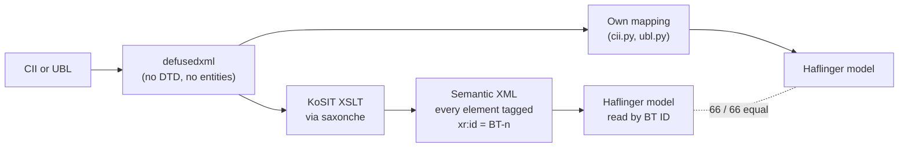

# Analysis 002: KoSIT XSLT and the official rules with Saxon (spike)

| Meta | Value |
| :- | :- |
| **Date** | 2026-10-30 |
| **Author** | loxy (drafted with Claude) |
| **Status** | Archived |
| **Audience** | Maintainer; input for the ADRs and specs |
| **Purpose** | Can KoSIT's reading XSLT and the official Schematron be run unchanged from Python? |
| **Branch** | `spike/kosit-xslt` |

> Archived on 2026-10-30. Its findings live in the ADRs, specs, architecture, guides and backlog; [analysis 005](analysis-005-arc42-setup.md) lists where each one went.

## Question

[ADR-003](../../arc42/adr/ADR-003-integrate-dont-implement.md) proposes to integrate the official artefacts instead of implementing the standard. Does that work in practice, in Python, without a JVM?

1. Can KoSIT's visualisation XSLT replace our own CII and UBL mapping for reading?
2. Can the official Schematron rules validate invoices through `saxonche`?
3. Does that hold against the official test material, including invalid examples?

## Setup

| Piece | Version |
| :- | :- |
| Saxon | `saxonche` 13.1.1 (SaxonC-HE), Python 3.14, Linux aarch64 |
| Reading | KoSIT `xrechnung-visualization` `v2026-10-13`: `cii-xr.xsl`, `ubl-invoice-xr.xsl`, `ubl-creditnote-xr.xsl` |
| Rules | KoSIT `validator-configuration-xrechnung` `v2026-08-31`: CEN EN 16931 Schematron 1.3.16, XRechnung 3.0.2 Schematron |
| Test data | KoSIT test suite `v2026-08-31` (66 files); CEN unit tests at commit `b17b269` (1,131 test cases, not vendored) |

The code: `src/haflinger/_saxon.py` (running a stylesheet), `src/haflinger/kosit.py` (KoSIT's semantic XML into Haflinger's model, by business term ID only), `src/haflinger/validate.py` (rules into findings), tests in `tests/conformance/test_kosit_xslt.py`. The artefacts are vendored unchanged in `src/haflinger/artefacts/`, with provenance READMEs.

## Results

### 1. Reading: KoSIT's XSLT gives the same model as our mapping

- **66 of 66 files read to the same model** as our own mapping, on all 43 business terms of REQ-001.
- One gap, closed with three lines of glue: KoSIT's stylesheet leaves XRechnung's `#ADU#` subject-code prefix in UBL note texts (BT-21, BT-22); our mapping splits it off. This also answers REQ-001's open question: the convention is real (the CII-to-UBL converter writes it), but KoSIT's rendering doesn't decode it.
- **Coverage: about 160 distinct business terms and groups** appear in the semantic XML of the test suite, against our 43. Comparing the semantic XML of each CII and UBL pair over all of them (numbers compared as numbers), the only differences left are differences in the test files themselves:

| Business term | Cases | Difference in the official files |
| :- | :- | :- |
| BT-13 purchase order reference | 7 | Only the UBL files have one (`Dummywert`) |
| BT-107, BT-108, BT-113, BT-114 | 6 | CII writes 0, UBL leaves the sum out (known, REQ-001-PRS-F004) |
| BT-35, BT-37, BT-38, BT-52, BT-53 addresses | 2 | Different placeholder texts |
| BT-31, BT-82, BT-107, BT-120 | 01.21a | Different values (known) |
| BT-45 buyer trading name | 03.01a | Only in UBL (known) |
| BT-29, BT-61, BT-122 | 03.07a | Only in one of the two files |

So KoSIT's mapping is consistent across the syntaxes for everything the suite contains, and our hand-written mapping matched it where it overlaps.

### 2. Validation: the official rules run unchanged

- **66 of 66 files pass** EN 16931 and XRechnung rules with no fatal or error finding (findings left: `BR-DE-TMP-32` information on 30 files, `CII-SR-475` and `CII-SR-476` warnings on 3).
- A total changed by one cent fails with **BR-CO-15** and **BR-CO-16**, as it should.

### 3. Invalid examples: CEN's per-rule unit tests

Each CEN unit test holds invoice fragments that must pass a rule and fragments that must fail it.

| Rules | Tests | Met | Not met |
| :- | :- | :- | :- |
| CEN's own stylesheet at the tests' commit (1.3.17) | 1,131 | **1,131** | 0 |
| The 1.3.16 rules bundled in KoSIT's configuration | 1,131 | 1,066 | 65 |

All 65 misses are rules for the Canary Islands (BR-IG) and Ceuta/Melilla (BR-IP) tax categories that changed in 1.3.17. Saxon runs the rules exactly; the misses are a version mismatch between test files and rules.

### Speed and size

| Step | Time |
| :- | :- |
| Starting Saxon | 0.02 s |
| Compiling the six stylesheets, once per process | 0.5 s |
| Reading one invoice through KoSIT's XSLT | 6 ms |
| Validating one invoice (EN 16931 and XRechnung) | 7 ms |

`saxonche` installs about 105 MB (a GraalVM native image). The vendored artefacts are 2.9 MB.

## Lessons

- **Give Saxon the original bytes.** The first run passed a tree re-serialised by ElementTree, and 18 valid CII files failed `PEPPOL-EN16931-R008` (no empty elements): re-serialising drops comments, so an element holding only a comment became empty. Saxon now gets the original bytes, after `defusedxml` has rejected DTDs and entities in them, which keeps the safety of REQ-001-PRS-NF001.
- **Pin rules and their tests to the same release.** Otherwise version drift looks like defects (section 3).
- **KoSIT's validator applies custom rule levels** from its scenario file (for example `CII-SR-475` and `CII-SR-476` lowered to information because of a wrong rule context in CEN 1.3.16). Running the stylesheets directly doesn't; Haflinger needs that bit of glue, or the scenario file.
- **Rendering is a security surface.** KoSIT's latest visualisation release fixes JavaScript injection through attachment file names (BT-122, BT-125). Showing invoices from outside as HTML needs the current release and care.

## Not covered

- Writing invoices; this spike only reads and validates.
- ZUGFeRD / Factur-X profiles other than XRechnung, especially EXTENDED: KoSIT's stylesheets target XRechnung and EN 16931; how they handle other CII content is untested.
- UBL credit notes: the stylesheet exists and is wired in, but the KoSIT suite has no credit note to test with.
- EN 16931-1:2026: KoSIT's semantic model is the 2017 one (namespace `…:en16931:2017:…`); it should follow with XRechnung 4.0.
- The Saxon licence: the package metadata names none; Saxonica publishes the HE edition as open source, which is to be confirmed before a release.

## Conclusion

ADR-003 holds for reading and validation. KoSIT's XSLT reads the KoSIT suite exactly as our mapping does, covers almost four times as many business terms, and is maintained with every XRechnung release; the official rules run unchanged and fast in Python. The price is a 105 MB runtime dependency.

## Recommended next steps

1. Make the KoSIT path the reader; keep `cii.py` and `ubl.py` for now as an independent oracle in the tests, and drop them when they get in the way.
2. Read the model from the semantic XML declaratively: a table from business term ID to model field, covering all terms KoSIT provides.
3. Try ZUGFeRD / Factur-X samples (the ZUGFeRD corpus) through the KoSIT path, to find its limits.
4. Vendor CEN's unit tests at the release of the bundled rules (EUPL-1.2) and run them in the tests.
5. Apply KoSIT's custom rule levels from the scenario file.
6. Confirm the Saxon licence; record the 105 MB in ADR-002.
