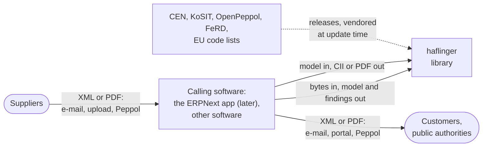
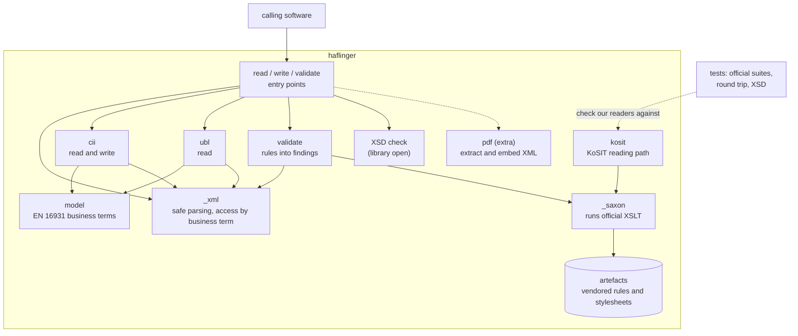
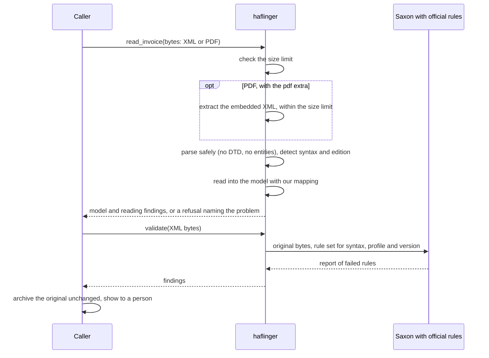
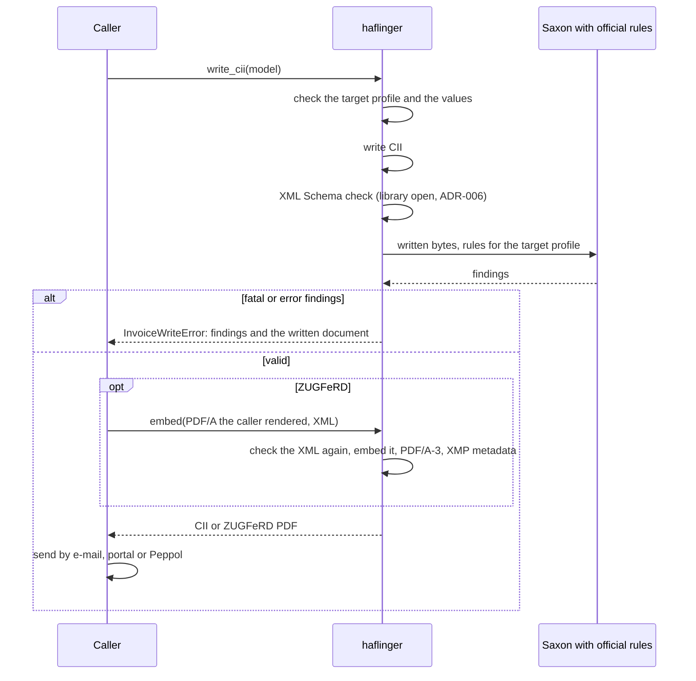
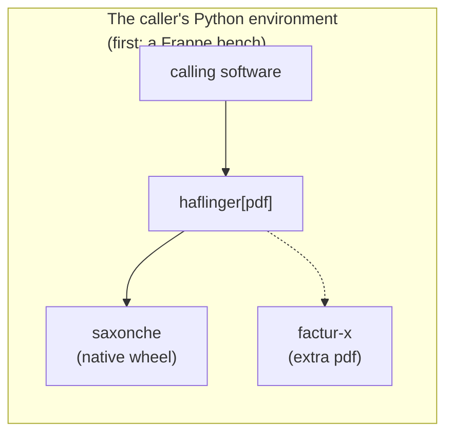

# Haflinger architecture

Compact [arc42](https://arc42.org/): all twelve sections in this file, until one of them outgrows it. It describes the design that the requirement specifications ([index](../specs/README.md)) and the [ADRs](adr/README.md) set out. Where the code disagrees, the code wins and this file is fixed.

**State:** a first layout. The code is being rebuilt from the specs; until a module lands on `main`, the modules named here exist only on the spike branches that proved them.

Diagrams are Mermaid, rendered by GitHub. Background on the standards, formats and bodies: [E-Invoicing 101](../guides/e-invoicing-101.md).

## 1. Introduction and goals

Haflinger is a Python library for e-invoicing (ZUGFeRD, XRechnung, Peppol), `haflinger`, that holds one model of the EN 16931 business terms. It reads invoices in CII and UBL and from ZUGFeRD PDFs, validates them with the official rules, and writes CII and ZUGFeRD PDFs. Any Python software can build on it. The first is a slim ERPNext app, later and in its own repository, that maps ERPNext's sales and purchase invoices to and from the model; this document describes the library.

Why it exists: ERPNext, its first user, has no complete e-invoicing. ALYF's European e-Invoice app is bound to CII, without UBL or Peppol ([ADR-001](adr/ADR-001-library-and-app.md)). Python has no mature library with a syntax-neutral model; the mature tools are Java.

### Quality goals

| # | Goal | Meaning |
| :- | :- | :- |
| 1 | **Correctness** | No value of an invoice is lost, changed or guessed, on the way in or out. Amounts stay exactly as written. What can't be read is refused or reported, never filled in. |
| 2 | **Conformance** | The official rules and test files decide what is right, not our reading of the standard. Haflinger runs them unchanged. |
| 3 | **Safety with hostile input** | Incoming invoices come from anyone. Neither XML nor PDF can make Haflinger fetch, expand or execute anything. |
| 4 | **Keeping current** | New releases of the standards, rules and test files are adopted mostly by agents, as a version bump and a test run. |
| 5 | **Fit into other software** | The library installs into its host's Python environment next to the versions the host pins, with few dependencies. The first host is a Frappe bench. |

### Stakeholders

| Who | Expects |
| :- | :- |
| Operator (runs the books in software built on Haflinger, ERPNext first) | Invoices in any format handled the same way; nothing wrong reaching the books unnoticed |
| Maintainer (keeps Haflinger current, usually an agent with a person reviewing) | Official test files as the reference; behaviour checkable without an ERP system |
| Integrator (the ERPNext app, other software built on the library) | One typed model independent of the syntax; refusals and findings that say what is wrong |
| Suppliers and customers | Their invoices accepted in the format they chose; Haflinger's invoices accepted by their software |
| Public authorities | XRechnung that passes their portals' validation (BT-10 Leitweg-ID, XRechnung rules) |
| Tax auditor | The original invoice archived unchanged, the booking traceable to it |
| Standards bodies (CEN, KoSIT, OpenPeppol, FeRD) | Not stakeholders who expect anything of Haflinger, but its upstream: their release cycles set its pace |

The first three are the personas of [REQ-001](../specs/req-001-core.md#personas).

## 2. Constraints

| Constraint | Source |
| :- | :- |
| Syntax and format knowledge lives only in the library; knowledge of one ERP system (the ERPNext mapping) lives in the software that uses it, outside this repository | [ADR-001](adr/ADR-001-library-and-app.md) |
| Python at runtime, no JVM; Java tools at most as oracles in CI | [ADR-001](adr/ADR-001-library-and-app.md), [ADR-003](adr/ADR-003-integrate-dont-implement.md) |
| Official artefacts (rules, mappings, code lists) and test files are used unchanged, pinned to a release, with their provenance | [ADR-003](adr/ADR-003-integrate-dont-implement.md); [ADR-008](adr/ADR-008-vendoring-official-files.md) |
| German law: a business must accept every EN 16931 invoice, in CII, UBL or as ZUGFeRD; the sender chooses the format | [101 guide §10](../guides/e-invoicing-101.md#10-the-law-briefly), [ADR-003](adr/ADR-003-integrate-dont-implement.md) |
| Installs next to the versions its host pins, a Frappe bench first: a lower bound on Python, few runtime dependencies, PDF support as an optional extra | [ADR-002](adr/ADR-002-toolchain.md) |
| Reading XML and PDFs needs no network and resolves nothing external; outside input has a size limit | [REQ-001](../specs/req-001-core.md) |
| Apache-2.0 for the library; the ERPNext app is GPL-3.0 in its own repository; "ERPNext" and "Frappe" not in the project or package name | [ADR-009](adr/ADR-009-licences-and-name.md), [AGENTS.md](../../AGENTS.md) |
| Nothing specific to one company in the repository | [AGENTS.md](../../AGENTS.md) |

## 3. Context and scope

| Interface | Direction | What |
| :- | :- | :- |
| Library API | caller → library | Python calls: read an invoice from bytes, write the model as CII, validate; PDF in and out with the `pdf` extra. Defined by [REQ-001](../specs/req-001-core.md), [REQ-002](../specs/req-002-conformance.md), [REQ-003](../specs/req-003-incoming-invoices.md) and [REQ-004](../specs/req-004-outgoing-invoices.md) |
| Official artefacts | upstream → repository | Rules, reading stylesheets and test files, taken from upstream releases at update time and vendored; nothing is fetched at runtime |
| Transport | caller ↔ suppliers and customers | Not the library's: e-mail, portals, and Peppol through a certified provider; no AS4 of Haflinger's own ([ADR-003](adr/ADR-003-integrate-dont-implement.md)) |

**Out of scope:** sending and receiving e-mail and Peppol messages (the caller, providers); archiving storage (the caller; Haflinger hands back the original bytes); bookkeeping decisions (a person, in the caller's system); the ERPNext app and its context, described in its own repository ([ITEM-003](../backlog/item-003-erpnext-app.md) until it exists); rendering invoices for people (later, with KoSIT's visualisation stylesheets, [ITEM-005](../backlog/item-005-rendering.md)).

## 4. Solution strategy

| Goal | Approach | Decision or requirement |
| :- | :- | :- |
| Correctness | One model of the EN 16931 business terms for every syntax; `Decimal` exactly as written; refuse or report instead of guessing | [ADR-001](adr/ADR-001-library-and-app.md), [REQ-001](../specs/req-001-core.md) |
| Correctness | Our own mapping reads; KoSIT's reading stylesheet reads the same files independently in the tests, so a mistake made the same way in our reader and writer still shows | [ADR-005](adr/ADR-005-own-mapping-kosit-as-check.md) |
| Conformance | The official Schematron runs unchanged with Saxon; the rule set is chosen by syntax, profile and version from BT-24 | [ADR-003](adr/ADR-003-integrate-dont-implement.md); [ADR-006](adr/ADR-006-validation-with-official-rules.md) |
| Conformance | The official test suites are the oracle, unchanged; where an official file looks wrong, the test records the exception with a reason | [AGENTS.md](../../AGENTS.md); [REQ-002](../specs/req-002-conformance.md) |
| Safety | XML parsed without DTDs and entities before anything else sees it, also when embedded in a PDF; every input limited in size | [REQ-001](../specs/req-001-core.md); [REQ-003](../specs/req-003-incoming-invoices.md); [§8](#8-cross-cutting-concepts) |
| Keeping current | Integrate, don't implement: what the standards bodies maintain is used, not rewritten; artefacts vendored per release | [ADR-003](adr/ADR-003-integrate-dont-implement.md); [ADR-008](adr/ADR-008-vendoring-official-files.md) |
| Keeping current | The model knows editions (EN 16931-1:2017 and :2026) by BT-24; its scope grows by what the specs need | [ADR-007](adr/ADR-007-model-scope-and-editions.md) |
| Fit into other software | No ERP code, few dependencies, PDF as an extra | [ADR-001](adr/ADR-001-library-and-app.md), [ADR-002](adr/ADR-002-toolchain.md) |
| All | Receive everything EN 16931 allows; send CII only, as ZUGFeRD EN 16931 or XRechnung 3.0 | [ADR-003](adr/ADR-003-integrate-dont-implement.md), [REQ-004](../specs/req-004-outgoing-invoices.md) |

How the requirements are cut into specs: [ADR-004](adr/ADR-004-specs-by-direction.md).

## 5. Building block view

| Block | Responsibility | State |
| :- | :- | :- |
| entry points (`read_invoice`, `write_cii`, `validate`) | Check size and safety, detect the syntax from the root element, dispatch, hand back a model with findings, a document, findings, or a refusal | `read_invoice` built (XML; PDFs later); the others spike |
| `model` | The business terms as frozen dataclasses with `Decimal` and `date`, each field mapped to its BT or BG ID by REQ-001; equal invoices compare equal whatever their syntax | Built, 45 terms in 6 groups |
| `_xml` | Parse outside XML with `defusedxml`; read elements by path, with `HAFL-VALUE` and `HAFL-DROPPED` findings that name the business term | Built |
| `cii`, `ubl` | The syntax bindings: each business term read from the element EN 16931-3-3 (CII) or -3-2 (UBL) assigns it, CII also written | Reading built; writing spike |
| `validate` | Choose the rule set, run it, turn the SVRL report into findings (rule, flag, location, text) | Spike: EN 16931 and XRechnung rules only; no Factur-X rules, no KoSIT levels |
| XSD check | Check a written invoice against the CII and Factur-X XML Schemas | Planned; library open ([ADR-006](adr/ADR-006-validation-with-official-rules.md)) |
| `kosit` | Read through KoSIT's stylesheet into the same model; the tests' independent second reader | Spike |
| `_saxon` | Compile each stylesheet once per process, run it on the original bytes | Spike |
| `artefacts` | KoSIT's visualisation stylesheets (the reading stylesheet) and validator stylesheets, unchanged, with provenance READMEs | Spike; KoSIT's scenario file and the Factur-X rules and XML Schemas to come |
| `pdf` | Extract the XML from a ZUGFeRD PDF without parsing it; embed checked XML into a PDF/A file the caller rendered (PDF/A-3, XMP), via `factur-x` | Planned, extra `pdf` |

Which spec owns which block: the placement map in the [specs index](../specs/README.md).

## 6. Runtime view

### Receiving an invoice

An incomplete invoice is read with what it holds, and the rules report the rest. Reading reports what it couldn't take into the model; it doesn't validate, and no finding stops an invoice from being read ([REQ-003-PRS-F008](../specs/req-003-incoming-invoices.md#req-003-prs-f008-findings-on-incoming-invoices)). What is refused is listed in [REQ-003-PRS-F006](../specs/req-003-incoming-invoices.md#req-003-prs-f006-refusals).

### Sending an invoice

An invalid invoice is refused with its findings and the written document; a model that can't be written at all (an unsupported profile, a value of the wrong type) is refused before writing ([REQ-004-PRS-F001](../specs/req-004-outgoing-invoices.md#req-004-prs-f001-one-entry-point)). Rendering the readable PDF as PDF/A is the caller's job (for ERPNext: [ITEM-003](../backlog/item-003-erpnext-app.md)).

## 7. Deployment view

The library is a Python package installed into the caller's Python environment. No service, no container, no network at runtime. The first host is a Frappe bench, where the ERPNext app and the library share one environment, so the library's dependencies have to fit the versions the bench pins ([ADR-002](adr/ADR-002-toolchain.md)).

Nothing is published yet; releases to PyPI are in the [backlog](../backlog/backlog.md). `saxonche` is a native wheel per platform; which platforms it covers, and its size, are in [ADR-006](adr/ADR-006-validation-with-official-rules.md).

## 8. Cross-cutting concepts

- **Hostile input:** XML is parsed with `defusedxml`, DTDs forbidden, before any other component sees it, also XML embedded in a PDF. Saxon then gets the original bytes, not a re-serialised tree ([ADR-006](adr/ADR-006-validation-with-official-rules.md)). Every input, and every file unpacked from a PDF, has a size limit (REQ-001). Rendering for people, later, needs the current KoSIT release, which fixed script injection through attachment names.

- **Exact values:** amounts, quantities, prices and rates are `Decimal` exactly as written, in XML Schema's decimal form; dates are `date`. Nothing is rounded on reading or on writing; the writer writes the digits the model holds. REQ-001 names the only two exceptions (whitespace on reading, exponent notation on writing).

- **Business terms as names:** each model field maps to its BT or BG ID; refusals name the business term, findings the rule ID (`BR-CO-15`). Haflinger's own findings have IDs starting `HAFL-`, all defined in REQ-002.

- **The original is the invoice:** the bytes received are the legal document to archive (GoBD). The model is a derived view, never the source for re-creating an incoming invoice. Content beyond the model (extensions, terms not modelled yet) stays in the original.

- **Official files as the reference:** behaviour is tested against the official suites and never adjusted by editing a file. A difference in the official files themselves is recorded in the test with the business term and the reason, and a further test fails once a new release removes it.

- **Vendoring:** official artefacts and test files are kept byte for byte (`.gitattributes`), pinned to a release, each with a README naming source, release, commit and licence. Rules and the tests that check them come from the same release; otherwise version drift looks like defects ([ADR-008](adr/ADR-008-vendoring-official-files.md)).

- **Editions, profiles, versions:** BT-24 tells which EN 16931 edition, which profile and which version an invoice follows; reading and validation choose by it ([ADR-006](adr/ADR-006-validation-with-official-rules.md), [ADR-007](adr/ADR-007-model-scope-and-editions.md)).

- **Testing:** unit tests per block; conformance tests over the official suites: CII and UBL agree, our reader and KoSIT's agree, written invoices read back unchanged and pass the XML Schema and the rules. Details per scenario in §10.

## 9. Architecture decisions

See the [ADR index](adr/README.md).

## 10. Quality requirements

The quality goals of section 1, made testable. The requirement column names the requirement that holds the test; the figures were measured in the spikes.

### Correctness

| ID | Scenario | Response and measure | Requirement |
| :- | :- | :- | :- |
| QS-01 | The same invoice arrives in CII and in UBL | The same model, for every business case of the KoSIT suite; differences in the official files listed with their reason | [REQ-003-PRS-F004](../specs/req-003-incoming-invoices.md#req-003-prs-f004-cii-and-ubl-agree) |
| QS-02 | An amount has more decimal places than its currency | Read and written back unchanged | [REQ-001-PRS-F004](../specs/req-001-core.md#req-001-prs-f004-exact-values) |
| QS-03 | Haflinger writes an invoice read from an official file | Our reader and KoSIT's both read it back to the same model; valid against the XML Schemas; measured: 66 of 66 KoSIT files with both readers and both XML Schemas, 180 of 180 corpus files with our reader and the CII XML Schema | [REQ-004-PRS-F006](../specs/req-004-outgoing-invoices.md#req-004-prs-f006-round-trip-over-the-kosit-suite) |
| QS-04 | An invoice total is off by one cent | Validation reports `BR-CO-15` and `BR-CO-16` as fatal | [REQ-002-PRS-F002](../specs/req-002-conformance.md#req-002-prs-f002-findings) |
| QS-11 | An invoice repeats a value the model holds once (two due dates) | The first is read, the second reported with `HAFL-DROPPED`; no value of a term the model holds is left out without a finding | [REQ-003-PRS-F002](../specs/req-003-incoming-invoices.md#req-003-prs-f002-reading-choices) |

### Conformance

| ID | Scenario | Response and measure | Requirement |
| :- | :- | :- | :- |
| QS-05 | CEN's per-rule unit tests run against the rules of the same release | Every expected pass and failure met; measured: 1,131 of 1,131, with CEN 1.3.16 and with 1.3.17 | [REQ-002-PRS-F007](../specs/req-002-conformance.md#req-002-prs-f007-official-verdicts-reproduced) |
| QS-06 | KoSIT, CEN or FeRD publishes a new release | One pull request updates the vendored files; the tests show what changed | [REQ-002-PRS-NF003](../specs/req-002-conformance.md#req-002-prs-nf003-traceable-to-a-release), [ADR-008](adr/ADR-008-vendoring-official-files.md) |

### Safety with hostile input

| ID | Scenario | Response and measure | Requirement |
| :- | :- | :- | :- |
| QS-07 | An XML file declares a DTD or an entity, also inside a PDF | Refused before any stylesheet or reader sees it | [REQ-001-PRS-NF001](../specs/req-001-core.md#req-001-prs-nf001-outside-input) |
| QS-12 | A small PDF carries an embedded file that inflates to gigabytes | Refused once the unpacked XML passes the size limit | [REQ-003-PRS-NF001](../specs/req-003-incoming-invoices.md#req-003-prs-nf001-embedded-files-within-the-limit) |

### Speed

Speed serves conformance: every invoice, received or sent, is validated.

| ID | Scenario | Response and measure | Requirement |
| :- | :- | :- | :- |
| QS-08 | A 25.7 MB invoice with 26,813 lines arrives or is sent | Measured: reading 0.8 s with our mapping (KoSIT's stylesheet: 11 minutes, which is why it is not the reader), the rules 6.7 s, writing 0.5 s; reading and validating the 61 MB invoice not yet measured; compiling the rules 0.5 s once per process | [REQ-002-PRS-NF002](../specs/req-002-conformance.md#req-002-prs-nf002-speed), [REQ-003-PRS-NF002](../specs/req-003-incoming-invoices.md#req-003-prs-nf002-speed), [REQ-004-PRS-NF001](../specs/req-004-outgoing-invoices.md#req-004-prs-nf001-speed) |

### Keeping current

| ID | Scenario | Response and measure | Requirement |
| :- | :- | :- | :- |
| QS-09 | An invoice of EN 16931-1:2026 arrives | Recognised by its edition from BT-24 and refused, naming the edition, until Haflinger supports it; never read as a 2017 invoice | [REQ-001-PRS-F003](../specs/req-001-core.md#req-001-prs-f003-edition), [REQ-002-PRS-F009](../specs/req-002-conformance.md#req-002-prs-f009-editions-supported), [ADR-007](adr/ADR-007-model-scope-and-editions.md) |

### Fit into other software

| ID | Scenario | Response and measure | Requirement |
| :- | :- | :- | :- |
| QS-10 | `haflinger` is installed into a Frappe bench, its first host | No Frappe import; without the `pdf` extra, no PDF dependencies | [REQ-001-PRS-NF002](../specs/req-001-core.md#req-001-prs-nf002-no-frappe), [ADR-002](adr/ADR-002-toolchain.md) |

## 11. Risks and technical debt

| Risk | Mitigation |
| :- | :- |
| Saxon: large, native, licence not yet confirmed ([ADR-006](adr/ADR-006-validation-with-official-rules.md)) | Confirm the licence before a release ([ADR-009](adr/ADR-009-licences-and-name.md)); check the platforms (open questions 1 and 2); without Saxon at runtime, incoming invoices couldn't be validated, so there is no fallback short of a new ADR |
| EN 16931-1:2026 and XRechnung 4.0, in parallel with 2017 for years ([ITEM-001](../backlog/item-001-en16931-2026.md)) | Edition-aware model from the start ([ADR-007](adr/ADR-007-model-scope-and-editions.md)); follow KoSIT's and CEN's releases |
| The model holds a sum without its parts (BT-107 without BG-20): harmless when reading, an invalid invoice when writing | Write a profile only when the model holds its terms; the writer's tests list the rules still missed (REQ-004) |
| Very large invoices | Our own mapping reads them; KoSIT's stylesheet only in tests; a size limit on every input (REQ-001) |
| Upstream timing: a fix in an official artefact waits for its release | Documented patch with a test, or wait; never a silent edit |
| Rules and their unit tests from different releases look like defects | Vendor both from the same release ([ADR-008](adr/ADR-008-vendoring-official-files.md)) |
| Libraries with a single maintainer (`factur-x`) | Kept behind Haflinger's own interface, replaceable |
| The official test files differ between CII and UBL in places | Recorded per case in the tests, rechecked with every release |
| An outgoing ZUGFeRD PDF is only PDF/A-3 if the rendered PDF was PDF/A | `embed` refuses other PDFs; veraPDF checks the results in the tests (REQ-004); producing PDF/A is the caller's (for ERPNext: [ITEM-003](../backlog/item-003-erpnext-app.md)) |
| One maintainer | Small own code, official tests as the reference, behaviour checkable without an ERP system |

### Open questions

| # | Question | Where to confirm | Affects |
| -- | :- | :- | :- |
| 1 | Is Saxon's size acceptable in a bench, and does any target lack a wheel ([ADR-006](adr/ADR-006-validation-with-official-rules.md))? | Maintainer, [backlog](../backlog/backlog.md) | §2, §7 |
| 2 | Saxon's licence for SaxonC-HE | Saxonica's licence terms, [backlog](../backlog/backlog.md) | [ADR-009](adr/ADR-009-licences-and-name.md) |
| 3 | The XSD library: lxml or `xmlschema`? | [ADR-006](adr/ADR-006-validation-with-official-rules.md), when REQ-004-PRS-F004 is built | §5 |
| 4 | Outdated versions and moved code lists | [REQ-002's open questions](../specs/req-002-conformance.md#open-questions) | §8 |
| 5 | The Python version of Frappe/ERPNext v16 benches against `requires-python >= 3.14` | [backlog](../backlog/backlog.md), [ADR-002](adr/ADR-002-toolchain.md) trigger 2 | §2 |

## 12. Glossary

Domain terms (EN 16931, CII, UBL, CIUS, profile, Leitweg-ID, Peppol …): the [101 guide's glossary](../guides/e-invoicing-101.md#glossary). Terms of the requirements: [REQ-001's Terms](../specs/req-001-core.md#terms). In addition:

| Term | Meaning |
| :- | :- |
| Official artefact | A file a standards body publishes and maintains: Schematron rules, reading stylesheets, XML Schemas, code lists, test files |
| Binding | The assignment of each business term to an element of one syntax (EN 16931-3-2 for UBL, -3-3 for CII) |
| KoSIT's reading stylesheet | KoSIT's visualisation stylesheets (`xrechnung-visualization`), used as the second reader: they turn CII and UBL into XML in which every element carries its business term ID |
| Finding | [REQ-002-PRS-F002](../specs/req-002-conformance.md#req-002-prs-f002-findings); Haflinger's own: [REQ-002-PRS-F010](../specs/req-002-conformance.md#req-002-prs-f010-haflingers-own-findings) |
| Round trip | [REQ-004's Terms](../specs/req-004-outgoing-invoices.md#terms) |
