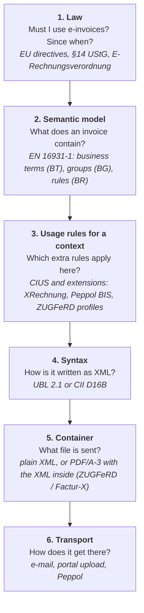
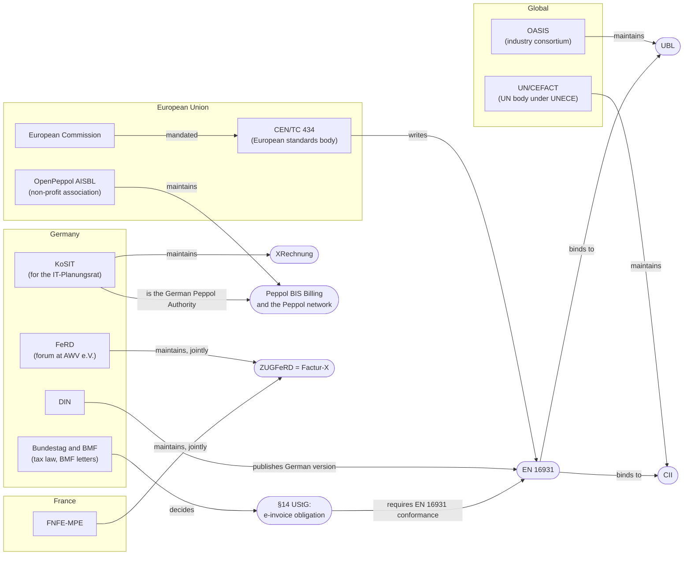
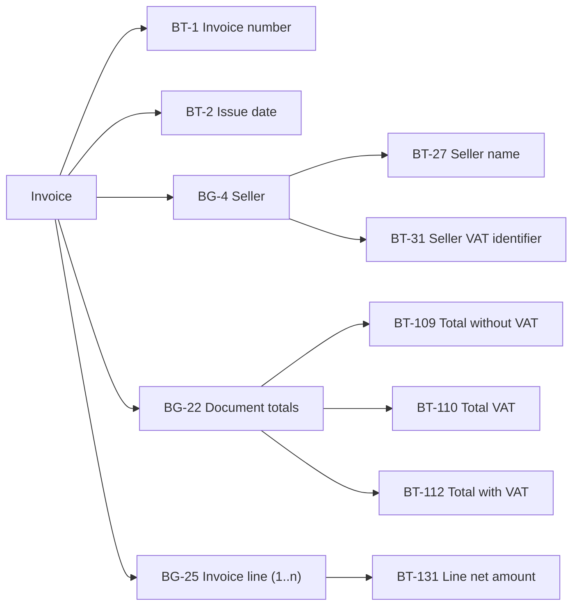
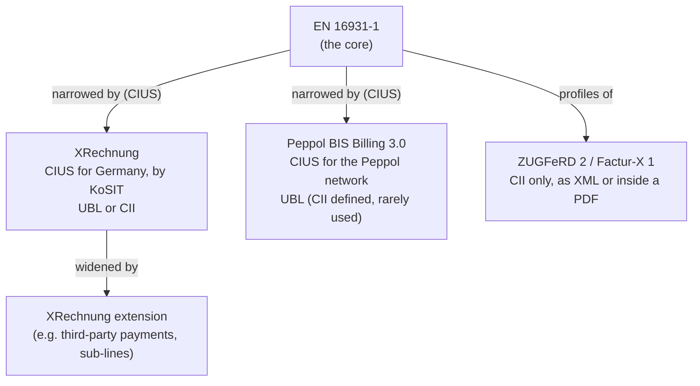
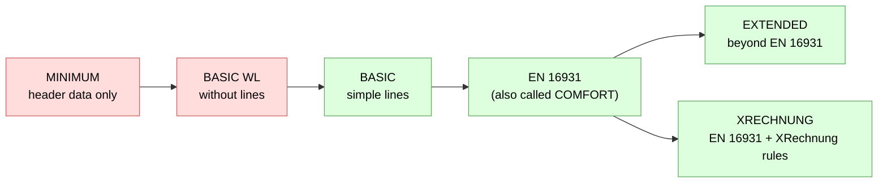
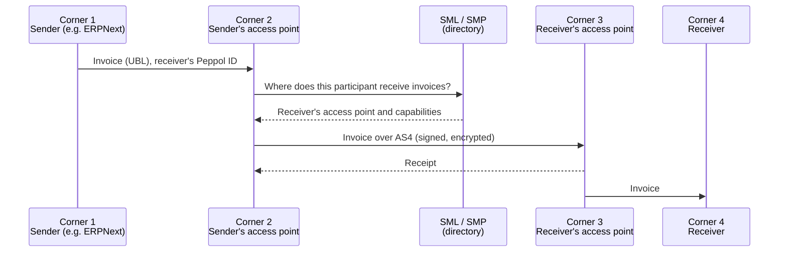
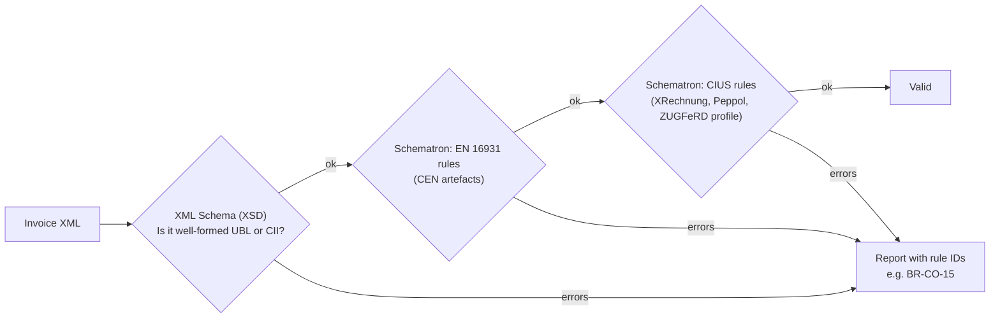
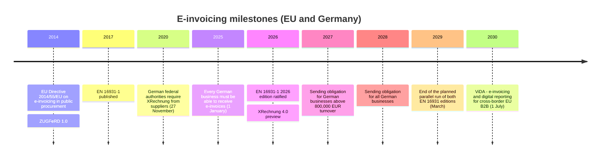
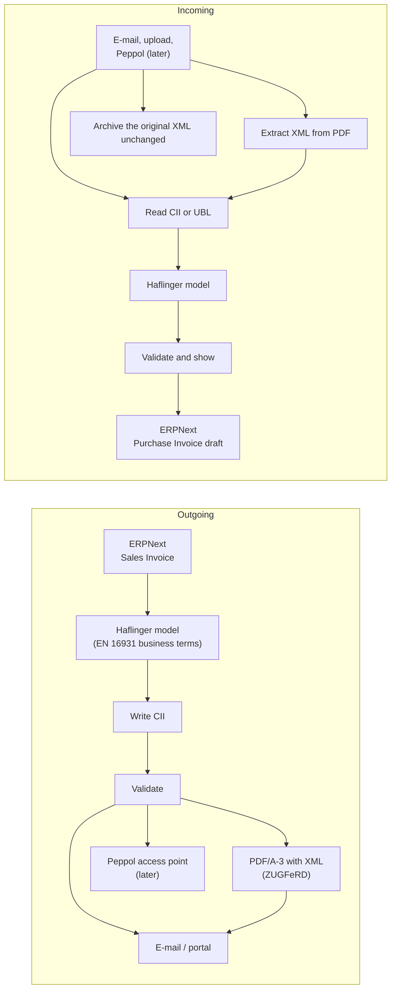

# E-Invoicing 101

| Meta | Value |
| :- | :- |
| **Date** | 2026-10-30 |
| **Author** | loxy (drafted with Claude) |
| **Status** | Kept current; dates and versions as of the date above |

An introduction for people who are new to e-invoicing (E-Rechnung). It explains the pieces (laws, standards, formats, organisations, networks) and how they connect, without hiding where the complexity is. Haflinger's own documents assume this background.

Read it top to bottom once; later, the [glossary](#glossary) at the end is the quick reference.

> Not legal or tax advice. Dates and versions are as of 2026-10-30; where something is still moving, the text says so.

## 1. The one-minute version

- An **e-invoice** is not a PDF. It is a **structured file (XML)** that software can read without guessing: every value (invoice number, VAT amount, IBAN, …) sits in a defined place.
- **What** an invoice must contain is defined once, for all of Europe, by the standard **EN 16931**. It names each value a **business term** (BT-1 is the invoice number, BT-112 the total with VAT, …).
- **How** those values are written as XML is defined twice: in **UBL** and in **CII**, two XML languages from two different organisations. Both are allowed; a receiver must accept both.
- Countries and communities narrow the standard down for their needs: Germany's **XRechnung**, Europe's **Peppol BIS**, the German–French **ZUGFeRD / Factur-X**.
- **ZUGFeRD / Factur-X** puts the XML *inside* a PDF, so a human sees a normal invoice and software reads the XML.
- The invoice travels by **e-mail**, via **portals**, or through the **Peppol network**.
- In Germany, every business must be able to **receive** e-invoices since 2025, and will have to **send** them from 2027/2028.

## 2. The layers

Almost every confusion in this field comes from mixing up layers. Each layer answers a different question, and each has its own owners and versions.



| Layer | Example question | Main documents | Owner |
| :- | :- | :- | :- |
| Law | Do I have to send e-invoices to my B2B customers? | Directive 2014/55/EU, ViDA, §14 UStG, ERechV | EU, Bundestag, BMF |
| Semantic model | Which values must every invoice have? | EN 16931-1 | CEN/TC 434 |
| Usage rules | Must the buyer reference be filled for German authorities? | XRechnung, Peppol BIS Billing 3.0, ZUGFeRD | KoSIT, OpenPeppol, FeRD/FNFE |
| Syntax | Which XML element holds the invoice number? | UBL 2.1, CII D16B, the syntax bindings | OASIS, UN/CEFACT, CEN |
| Container | Is a PDF with embedded XML allowed? | ZUGFeRD / Factur-X specification, PDF/A-3 | FeRD, FNFE-MPE, ISO |
| Transport | How do I reach a customer's system? | Peppol (AS4, SMP), e-mail | OpenPeppol, providers |

## 3. Who is in charge of what



- **CEN/TC 434** is the technical committee of the European standards body CEN that writes EN 16931. The European Commission asked for it in Directive 2014/55/EU. The Commission's "eInvoicing" building block hosts supporting material: code lists and the validation artefacts on GitHub (`ConnectingEurope/eInvoicing-EN16931`).
- **OASIS** is an industry consortium; its UBL (Universal Business Language) is also an ISO standard (ISO/IEC 19845).
- **UN/CEFACT** is the UN centre for trade facilitation; its Cross Industry Invoice (CII) is part of a large family of trade documents.
- **KoSIT** (Koordinierungsstelle für IT-Standards, Bremen) works for the IT-Planungsrat of the German federal and state governments. It maintains XRechnung and publishes free tools: a validator, a test suite and a visualisation. It is also Germany's Peppol Authority.
- **FeRD** (Forum elektronische Rechnung Deutschland, part of AWV e.V.) maintains ZUGFeRD; **FNFE-MPE** in France maintains Factur-X. Since ZUGFeRD 2.1 / Factur-X 1.0, the two are the same specification under two names.
- **OpenPeppol** runs the rules of the Peppol network. Certified commercial providers run its access points.
- **The BMF** (Federal Ministry of Finance) explains the German tax law in letters (BMF-Schreiben) that say, for example, which ZUGFeRD profiles count as e-invoices.

## 4. EN 16931: the common model

EN 16931 is a family of documents. The parts that matter:

| Part | What it is |
| :- | :- |
| **EN 16931-1** | The semantic model: about 160 business terms (2017 edition), their cardinality, and the business rules. The heart of everything. |
| CEN/TS 16931-2 | The list of allowed syntaxes: UBL and CII (and UN/EDIFACT, rarely used). |
| CEN/TS 16931-3-2, -3-3 | The **syntax bindings**: for each business term, the exact element in UBL (-3-2) and CII (-3-3). |
| CEN/TR 16931-5 | How to write a CIUS or an extension (section 6). |

### Business terms, groups, rules



- A **business term (BT)** is one value: BT-1 invoice number, BT-112 total amount with VAT.
- A **business group (BG)** is a set of terms that belong together, possibly repeated: BG-25 is one invoice line.
- A **business rule (BR)** is a condition: "an invoice shall have an invoice number" (BR-02), "the total with VAT is the total without VAT plus the VAT total" (BR-CO-15). Rule families: `BR-` general, `BR-CO-` calculations, `BR-S-`, `BR-AE-`, … per VAT category.
- **Code lists** fix the allowed values: currency (ISO 4217), country (ISO 3166), unit of measure (UN/ECE Recommendation 20), invoice type (UNTDID 1001: 380 invoice, 381 credit note), payment means (UNTDID 4461), VAT exemption reasons (VATEX), electronic address schemes (EAS). The European Commission publishes them in a registry, updated several times a year.

### Two editions

| Edition | Status (2026-10) | Syntaxes |
| :- | :- | :- |
| EN 16931-1:2017 | In force everywhere today | UBL 2.1, CII D16B |
| EN 16931-1:2026 | Ratified in February 2026, English version since March 2026; syntax bindings and validation artefacts still pending | UBL 2.5, CII D25A (as implemented ahead of the official bindings by phax's converter) |

The 2026 edition adds 52 business terms and 7 groups (for example several orders and deliveries per invoice, discounts, late-payment interest) and prepares for ViDA. Both editions run in parallel until March 2029, as currently planned. The edition is recognisable from BT-24 (the specification identifier), not from the XML namespace, which stays the same.

## 5. UBL and CII: two ways to write the same thing

Both are XML. Both can carry every EN 16931 business term. They differ in structure and origin:

|  | UBL | CII |
| :- | :- | :- |
| Full name | Universal Business Language | Cross Industry Invoice |
| Owner | OASIS | UN/CEFACT |
| Version for EN 16931:2017 | 2.1 | D16B |
| Shape | Flat, close to the paper invoice | Deeply nested, organised by trade agreement, delivery and settlement |
| Separate credit note | Yes, its own root element (`CreditNote`) | No, the type code (381) says it |
| Typical users | Peppol, Nordic and Benelux countries, XRechnung | ZUGFeRD / Factur-X, XRechnung |

The same invoice number (BT-1) and total (BT-112) in both:

```xml
<!-- UBL -->
<Invoice xmlns="urn:oasis:names:specification:ubl:schema:xsd:Invoice-2" …>
  <cbc:ID>123456XX</cbc:ID>
  …
  <cac:LegalMonetaryTotal>
    <cbc:TaxInclusiveAmount currencyID="EUR">336.9</cbc:TaxInclusiveAmount>
  </cac:LegalMonetaryTotal>
</Invoice>
```

```xml
<!-- CII -->
<rsm:CrossIndustryInvoice xmlns:rsm="urn:un:unece:uncefact:data:standard:CrossIndustryInvoice:100" …>
  <rsm:ExchangedDocument>
    <ram:ID>123456XX</ram:ID>
  </rsm:ExchangedDocument>
  <rsm:SupplyChainTradeTransaction>
    …
    <ram:ApplicableHeaderTradeSettlement>
      <ram:SpecifiedTradeSettlementHeaderMonetarySummation>
        <ram:GrandTotalAmount>336.9</ram:GrandTotalAmount>
      </ram:SpecifiedTradeSettlementHeaderMonetarySummation>
    </ram:ApplicableHeaderTradeSettlement>
  </rsm:SupplyChainTradeTransaction>
</rsm:CrossIndustryInvoice>
```

The differences go beyond element names. A few examples:

- The seller's legal name is `PartyLegalEntity/RegistrationName` in UBL but simply `Name` in CII; the trading name is the other way round.
- XRechnung's convention puts a note's subject code into UBL's note text (`#ADU#…`), while CII has a separate element.
- When the VAT total also has to be stated in a second currency, UBL repeats the whole tax-total block, while CII repeats one amount with another currency attribute.

That is why a software needs a mapping per syntax, and why Haflinger maps both to one model of business terms ([ADR-001](../arc42/adr/ADR-001-library-and-app.md)).

## 6. CIUS and extensions: narrowing and widening

EN 16931 is deliberately generic: many terms are optional. A **CIUS** (Core Invoice Usage Specification) narrows it for a context, for example by making optional terms mandatory or restricting code lists. An invoice that conforms to a CIUS still conforms to EN 16931. An **extension** goes the other way and adds terms the standard doesn't have; such an invoice is no longer plain EN 16931.



- **XRechnung** is mandatory for invoices to German public authorities. It requires, among other things, the buyer reference (BT-10), which for authorities is the **Leitweg-ID**, the routing address of the receiving office. XRechnung 3.0 is current; 4.0 (for EN 16931:2026) has been out as a preview since September 2026, with the final release expected in 2027.
- **Peppol BIS Billing 3.0** is the CIUS for invoices sent over the Peppol network; national rules (Germany, Netherlands, …) add a few more.
- **ZUGFeRD / Factur-X** defines **profiles**, from almost nothing to more than EN 16931:



Red profiles are **not** e-invoices under German law (they lack the invoice lines, per the BMF); they are only booking aids. Green profiles count.

## 7. The container: plain XML or hybrid PDF

| Form | What it is | Who reads it |
| :- | :- | :- |
| Plain XML | The UBL or CII file alone | Software only; humans need a viewer (KoSIT publishes one as XSLT) |
| Hybrid (ZUGFeRD / Factur-X) | A PDF/A-3 with the CII XML embedded as an attachment (`factur-x.xml`, or `xrechnung.xml` in the XRECHNUNG profile) | Humans read the PDF, software reads the XML |
| Plain PDF, paper | No structured data | Not an e-invoice in Germany ("sonstige Rechnung") |

In a hybrid invoice, **the XML is the invoice**. If PDF and XML disagree, the XML counts, and the XML is what must be archived. PDF/A-3 is an archival PDF standard (ISO 19005-3) that allows embedded files; producing a correct one (fonts, colour profiles, XMP metadata) is harder than it sounds.

## 8. Transport: how an invoice travels

In Germany, B2B e-invoices may travel any way the parties agree; e-mail is the most common. Invoices to federal authorities go through the federal portals (ZRE, OZG-RE), which accept upload, e-mail and Peppol.

**Peppol** is a European network for business documents, built on the **four-corner model**: sender and receiver each choose an access point (a certified provider), and the access points exchange the document. Nobody needs a direct connection to their counterparty.



- A **Peppol participant ID** combines a scheme code (ICD / EAS, e.g. `0204` for a Leitweg-ID, `9930` for a German VAT ID) and an identifier.
- The **SML** (Service Metadata Locator) is a central DNS-based index; the **SMP** (Service Metadata Publisher) says which documents a participant accepts and at which access point.
- **AS4** is the transport protocol between access points.
- Peppol matters more each year: several EU countries use it for their domestic B2B mandates, and ViDA's cross-border rules point the same way.

## 9. Checking an invoice: validation



- **XML Schema** checks the structure: right elements, right order, right data types.
- **Schematron** checks the business rules: sums add up, required terms are present, codes are from the lists. The rules are published as XSLT and need an XSLT processor such as **Saxon**.
- The **KoSIT validator** (Java) bundles all of this for XRechnung and produces a report with a recommendation (accept or reject).
- Each rule set has its own releases: CEN's EN 16931 artefacts (v1.3.17, 2026-10-09), XRechnung's, Peppol's (usually twice a year), ZUGFeRD's. Keeping up with them is a continuous task.
- Official test material exists for all of them: example invoices, and per-rule unit tests with examples that must pass and examples that must fail ([ITEM-002](../backlog/item-002-official-test-material.md) lists the sources).

## 10. The law, briefly



- **B2G (to public authorities)**: Directive 2014/55/EU obliges public bodies to accept EN 16931 invoices. Germany implemented it with the E-Rechnungsverordnung (federal) and state laws, and demands XRechnung.
- **B2B in Germany**: since 2025, §14 UStG defines an e-invoice as a structured electronic format that allows electronic processing and conforms to EN 16931 (other formats only if the data can be extracted in an EN 16931-compatible way). Receiving is mandatory since 1 January 2025. Paper and plain PDF remain allowed for sending until the end of 2026, for businesses with up to 800,000 EUR prior-year turnover until the end of 2027, and EDI until the end of 2027. The BMF letters explain the details.
- **ViDA** (VAT in the Digital Age) is an EU reform adopted in 2025. From July 2030, cross-border B2B invoices within the EU must be e-invoices following EN 16931, reported to the tax authorities in near real time (digital reporting requirements). Member states may introduce domestic mandates without asking Brussels first.
- **Archiving**: the e-invoice (the XML) must be kept unchanged and readable for the statutory period (GoBD).
- Further German specifics keep coming, for example a note on cash-basis taxation (Ist-Versteuerung) on the invoice, which the Jahressteuergesetz 2024 brought into the discussion; whether and from when it is required is to be confirmed against the current §14(4) UStG. Such notes go into BT-22.

## 11. Where Haflinger fits



Haflinger receives every format the law allows and sends CII only. How it does that: the [architecture](../arc42/README.md), section 5 for what is built so far, section 6 for these two flows.

## 12. Where the complexity hides

- **Versions on every layer.** EN 16931 2017 and 2026, UBL 2.1 and 2.5, CII D16B and D25A, XRechnung 3.0 and 4.0, ZUGFeRD releases, Schematron releases twice a year, code lists several times a year. They move independently.
- **"Valid" depends on whom you ask.** An invoice can be valid EN 16931 but invalid XRechnung, or valid ZUGFeRD BASIC WL but not an e-invoice under German tax law.
- **Calculation rules.** Totals, rounding (BT-114), allowances and charges, VAT per category must add up exactly as EN 16931 defines; an ERP's own rounding often differs.
- **German payment terms.** Early-payment discounts (Skonto) have no proper business term in EN 16931:2017; XRechnung encodes them in a text convention (`#SKONTO#TAGE=…#`).
- **Several currencies.** The VAT total must also be stated in the VAT accounting currency when it differs (BT-111).
- **Notes and free text.** Subject codes, legal notes, conventions that differ between CIUS.
- **Hybrid invoices.** PDF and XML can disagree; only the XML counts.
- **Incoming reality.** Real invoices are often not fully valid. Software has to decide whether to reject them, or read them and warn.
- **Identity.** Who is the supplier in your system? Matching VAT IDs, names, Leitweg-IDs, Peppol IDs to ERP records is half the work of processing an incoming invoice.

## Glossary

| Term | Meaning |
| :- | :- |
| **Access point** | A certified provider that sends and receives documents in the Peppol network. |
| **AS4** | The message protocol between Peppol access points. |
| **AWV** | Arbeitsgemeinschaft für wirtschaftliche Verwaltung e.V., the association FeRD belongs to. |
| **B2B / B2G** | Business to business / business to government. |
| **BG / BT / BR** | Business group / business term / business rule of EN 16931. |
| **BMF** | Bundesministerium der Finanzen, the German Federal Ministry of Finance. |
| **CEN/TC 434** | The CEN technical committee that writes EN 16931. |
| **CII** | UN/CEFACT Cross Industry Invoice, one of the two XML syntaxes. |
| **CIUS** | Core Invoice Usage Specification: rules that narrow EN 16931 for a context. |
| **Code list** | The allowed values for a coded term (currencies, units, VAT categories, …). |
| **D16B, D25A** | Releases of the UN/CEFACT library that CII is part of. |
| **DRR** | Digital reporting requirements: invoice data reported to the tax authority, part of ViDA. |
| **EAS / ICD** | Code lists for electronic address and identifier schemes (used in Peppol IDs). |
| **EN 16931** | The European standard for the semantic model of an e-invoice. |
| **ERechV** | E-Rechnungsverordnung, the German federal regulation for invoices to federal authorities. |
| **Extension** | Rules that add terms beyond EN 16931 (XRechnung extension, ZUGFeRD EXTENDED). |
| **Factur-X** | The French name of ZUGFeRD 2. |
| **FeRD** | Forum elektronische Rechnung Deutschland, maintains ZUGFeRD. |
| **FNFE-MPE** | Forum National de la Facture Électronique et des Marchés Publics Électroniques, maintains Factur-X. |
| **GoBD** | German principles for keeping books and records electronically, including archiving. |
| **Hybrid invoice** | A PDF with the structured XML embedded (ZUGFeRD / Factur-X). |
| **KoSIT** | Koordinierungsstelle für IT-Standards, maintains XRechnung, German Peppol Authority. |
| **Leitweg-ID** | The routing identifier of a German public authority, carried in BT-10. |
| **OASIS** | The consortium that maintains UBL. |
| **OpenPeppol** | The association that governs the Peppol network. |
| **OZG-RE, ZRE** | The federal e-invoice receiving portals in Germany. |
| **PDF/A-3** | Archival PDF standard that allows embedded files. |
| **Peppol** | Pan-European network and specifications for exchanging business documents. |
| **Peppol BIS Billing 3.0** | The Peppol CIUS for invoices and credit notes. |
| **Profile** | A level of a ZUGFeRD / Factur-X invoice: MINIMUM, BASIC WL, BASIC, EN 16931, XRECHNUNG, EXTENDED. |
| **Saxon** | An XSLT processor, needed to run the Schematron rules. |
| **Schematron** | A language for business rules over XML, used for validation. |
| **SML / SMP** | Peppol's central locator and the per-participant metadata publisher. |
| **Syntax binding** | The mapping of each business term to an element of a syntax (CEN/TS 16931-3-x). |
| **UBL** | OASIS Universal Business Language, one of the two XML syntaxes. |
| **UN/CEFACT** | UN Centre for Trade Facilitation and Electronic Business, maintains CII. |
| **ViDA** | VAT in the Digital Age, the EU reform that brings cross-border e-invoicing in 2030. |
| **XRechnung** | The German CIUS of EN 16931, mandatory for invoices to German authorities. |
| **XSD** | XML Schema, checks the structure of an XML file. |
| **ZUGFeRD** | Zentraler User Guide des Forums elektronische Rechnung Deutschland: hybrid PDF invoices with embedded CII, in profiles. |

## Further reading

- KoSIT: [XRechnung](https://xeinkauf.de/xrechnung/), [EN 16931 status and XRechnung 4.0](https://xeinkauf.de/aktuelles/xse/en-16931-aktueller-stand-und-ausblick-auf-die-einfuehrung-der-xrechnung-4-0/)
- CEN validation artefacts: [ConnectingEurope/eInvoicing-EN16931](https://github.com/ConnectingEurope/eInvoicing-EN16931)
- Peppol: [OpenPeppol](https://peppol.org/), [Peppol BIS Billing 3.0](https://docs.peppol.eu/poacc/billing/3.0/)
- ZUGFeRD: [FeRD](https://www.ferd-net.de/)
- Haflinger: [architecture](../arc42/README.md), [specs](../specs/README.md), [ADRs](../arc42/adr/README.md)
